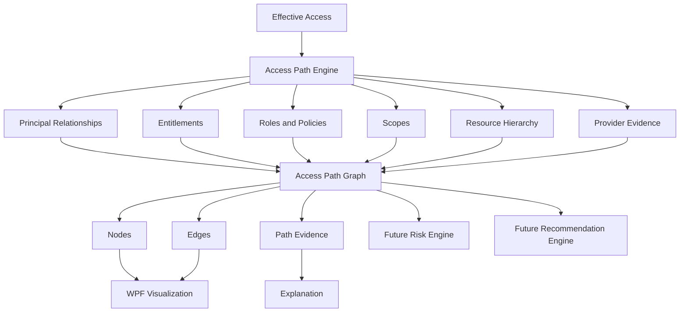

# Multi-Cloud Access Path Engine

The Access Path Engine consumes the authoritative `EffectiveAccess` result from Milestone 10 and explains how the principal obtained that result. It does not recalculate Allow/Deny, perform cloud calls, or implement risk scoring.

## Graph Model

Paths contain typed nodes for principals, groups, nested groups, roles, policies, permissions, conditions, scopes, and resources. Edges preserve relationships such as `MemberOf`, `AssignedRole`, `AssignedPolicy`, `GrantsPermission`, `ConditionApplies`, `ScopedAt`, and `AppliesTo`. Every node and edge carries an evidence reference where available.

The engine supports all known paths or the shortest complete path. Duplicate logical paths are removed deterministically. Traversal depth, node count, path count, and operation limits prevent graph explosion. Group traversal uses visited sets and cannot recurse indefinitely through circular memberships.

## Decision and Evidence

The engine trusts `EffectiveAccess.Decision` and `EvaluationStatus`. Denied and conditional results remain visible, including their contributing relationships and condition nodes. Missing relationships produce partial/unknown diagnostics rather than fabricated nodes or explanations.

## Provider Paths

Azure paths can include group membership, role assignment, role definition, action/data action, scope, and resource. AWS paths preserve identity/resource policy and AssumeRole/trust relationships as distinct relationships. GCP paths preserve groups, IAM bindings, roles, conditions, and organization/folder/project inheritance.

Kubernetes workload traces add Pod/Deployment → ServiceAccount → Kubernetes RBAC → cloud identity edges. EKS, GKE, and AKS federation checks retain their evidence and status on the cloud-identity edge. Trust verification does not claim that a runtime token was exchanged or that downstream cloud permissions allow an action.

## Persistence and Performance

`AccessPath`, `AccessPathNode`, and `AccessPathEdge` are relationally persisted with provider, principal, resource, permission, effective-access, status, and path-type indexes. Evidence and diagnostics are retained as JSON/text metadata. The engine builds adjacency lookups in memory and does not access cloud APIs.

The current milestone intentionally defers advanced WPF graph visualization, full AssumeRole resolution where trust evidence is incomplete, and risk/recommendation calculations.
