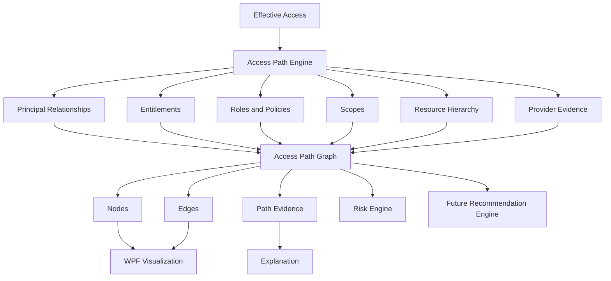

# Multi-Cloud Access Path Engine

The Access Path Engine consumes the authoritative `EffectiveAccess` result from Milestone 10 and explains how the principal obtained that result. It does not recalculate Allow/Deny, perform cloud calls, or implement risk scoring.

## Graph Model

Paths contain typed nodes for principals, groups, nested groups, roles, policies, permissions, conditions, scopes, and resources. Edges preserve relationships such as `MemberOf`, `AssignedRole`, `AssignedPolicy`, `GrantsPermission`, `ConditionApplies`, `ScopedAt`, and `AppliesTo`. Every node and edge carries an evidence reference where available.

The engine supports all known paths or the shortest complete path. Duplicate logical paths are removed deterministically. Traversal depth, node count, path count, and operation limits prevent graph explosion. Group traversal uses visited sets and cannot recurse indefinitely through circular memberships. Resource evidence nodes include public exposure, sensitive data, workload vulnerabilities, and critical assets. Unconfirmed signals and unavailable/partial coverage are retained as explicit graph nodes with status/freshness metadata rather than omitted.

## Decision and Evidence

The engine trusts `EffectiveAccess.Decision` and `EvaluationStatus`. Denied and conditional results remain visible, including their contributing relationships and condition nodes. Missing relationships produce partial/unknown diagnostics rather than fabricated nodes or explanations.

## Provider Paths

Azure paths can include group membership, role assignment, role definition, action/data action, scope, and resource. AWS paths preserve identity/resource policy and AssumeRole/trust relationships as distinct relationships. GCP paths preserve groups, IAM bindings, roles, conditions, and organization/folder/project inheritance.

Kubernetes workload traces add Pod/Deployment → ServiceAccount → Kubernetes RBAC → cloud identity edges. EKS, GKE, and AKS federation checks retain their evidence and status on the cloud-identity edge. Trust verification does not claim that a runtime token was exchanged or that downstream cloud permissions allow an action.

## Attack-Path Trust and Reachability

The attack-path graph reuses the normalized identity inventory, effective-access result, provider trust evidence, and resource-risk signals. It does not infer a relationship from similar identity names. AWS role trust is matched against exact principal ARNs or account-root ARNs; source-side `sts:AssumeRole` access is checked separately. AWS OIDC and Azure Entra federated credentials retain issuer, subject, audience, and claims/condition evidence. If the external workload or its runtime token claims are not inventoried, the graph adds an explicitly labelled external identity and keeps the edge unverified.

GCP service-account IAM policies are read per service account. The mapper recognizes the built-in `serviceAccountTokenCreator`, `workloadIdentityUser`, and `serviceAccountOpenIdTokenCreator` roles. It evaluates a bounded CEL subset for `resource.name`, `resource.type`, `request.time`, boolean composition, comparisons, and membership; unsupported expressions remain unknown. A failed condition is represented as denied. GCP trust edges remain potential because organization-level IAM deny policies and principal access boundary constraints are not evaluated by this provider path.

Verified reachability requires every edge to be supported by complete provider evidence and fully evaluated authorization. Unknown trust or runtime claims remain theoretical; partially evaluated or conditional authorization remains potential. An external trust source is an explicitly configured authentication boundary, not evidence that an attacker has compromised that source. Evidence is retained on each edge, and traversal limits and cycle detection prevent unbounded graph growth.

The graph is a static authorization/trust model, not proof of token exchange, compromise, or exploitation. Provider APIs do not expose the live token assertion or all request context, so conditional federation cannot be asserted satisfied without that context. GCP custom roles are inspected when readable, but deny policies, principal access boundaries, and other provider-specific policy overlays remain outside this graph evaluation and must not be interpreted as verified access.
