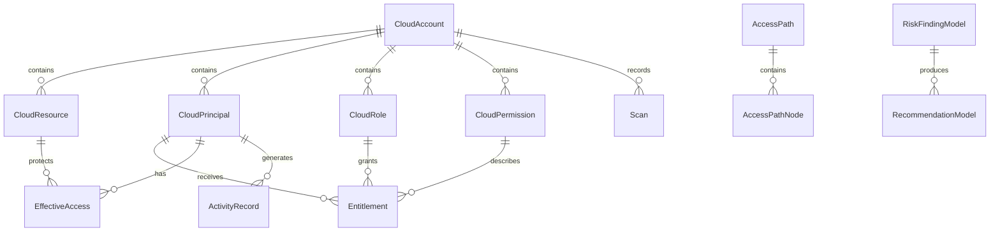

# SQLite Persistence Schema

The Infrastructure layer persists normalized CIEM metadata with EF Core and SQLite. The Domain project remains persistence-ignorant.

## Location

Runtime databases are stored under:

`%LOCALAPPDATA%\CloudEntitle\Data\cloudentitle.db`

The path is supplied by `DatabaseConfiguration`; it is not hard-coded to a developer machine. Automated tests use in-memory SQLite or isolated temporary directories.

## Tables and Relationships

The schema also stores policies, assignments, group memberships, audit events, risk rules, and scan history. Security and audit relationships use restrictive delete behavior to avoid accidental historical data loss.

## Indexes

Indexes target provider/account lookups, principal status and privilege, resource ownership, entitlement scope, effective access, risk severity/status, activity timelines, and scan history. JSON fields are stored as SQLite `TEXT` using deterministic `System.Text.Json` conversions for tags, audit metadata, and evidence.

Policy documents are preserved as text so provider-specific policy semantics are not altered by persistence.

## Migrations and Initialization

`InitialCiEMSchema` is the EF Core source of truth. `DbInitializer` creates the app-data directory and applies pending migrations. Database errors are logged with Serilog and surfaced as a useful initialization exception without exposing credentials.

## Security

The database stores authorization metadata, not credentials. Passwords, access tokens, refresh tokens, client secrets, private keys, API keys, and license secrets are intentionally outside this persistence model.
