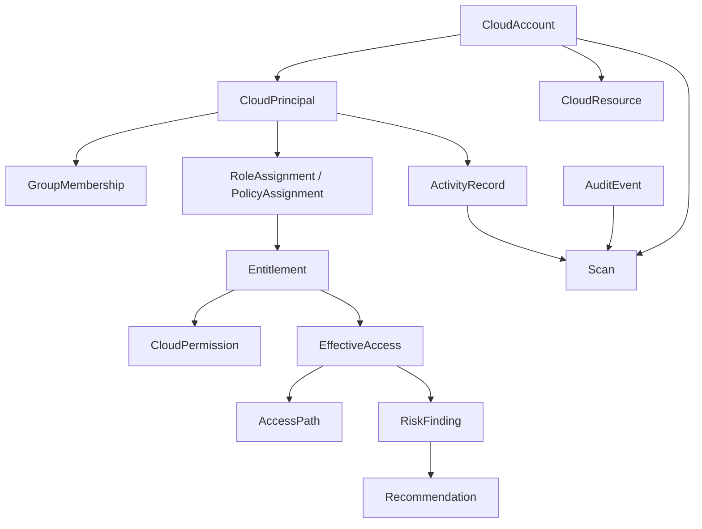

# Normalized CIEM Domain Model

The domain project is provider-independent. Azure, AWS, and GCP adapters map their native accounts, principals, assignments, policies, and resources into the same normalized entities without introducing SDK types into `CloudEntitle.Domain`.

## Core Entities

- `CloudAccount` stores a provider-neutral account identifier, account type, hierarchy, and scan metadata. Credentials are never part of the model.
- `CloudResource` stores provider identifiers as opaque external IDs, hierarchy, URI, location, and tags.
- `CloudPrincipal` represents users, groups, service principals, managed identities, service accounts, roles, and applications. Email is optional.
- `CloudGroup` and `GroupMembership` represent memberships without assuming that members are human users.
- `CloudRole`, `CloudPolicy`, and `CloudPermission` keep provider interpretation outside the domain layer. Wildcards are represented by the permission action or resource pattern.
- `Entitlement`, `RoleAssignment`, and `PolicyAssignment` preserve direct, group, inherited, role, policy, and application sources.
- `EffectiveAccess` represents the resulting allow/deny permission at a scope and resource. It records direct versus inherited state and can reference an `AccessPath`.
- `RiskFinding` stores rule, severity, lifecycle status, evidence, and references to the affected normalized entities. `Recommendation` is a separate entity so a finding can have multiple recommendations later.
- `ActivityRecord` and `Scan` provide the future foundations for usage analysis and scan history. `AuditEvent` records operational events without secrets.

Provider adapters should map opaque provider IDs into `ExternalId` values and preserve the original scope and resource identifiers. Provider-specific role semantics, policy parsing, inheritance rules, and access calculation belong outside this project.
