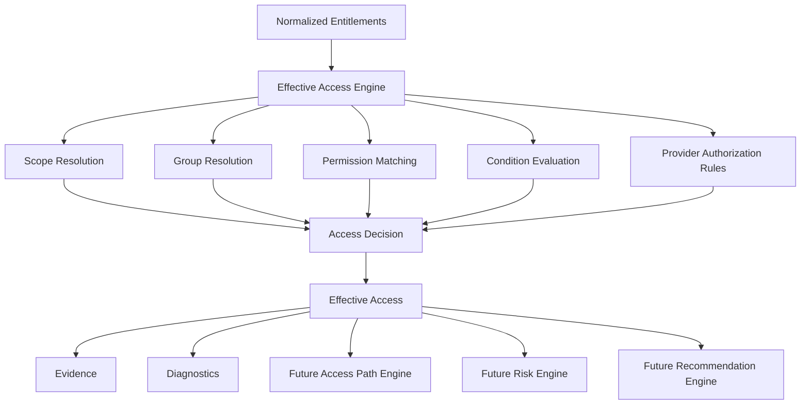

# Multi-Cloud Effective Access Engine

The Effective Access Engine consumes normalized entitlements and answers who can perform which permission on which resource. It is separated from cloud connectors, normalization, WPF, risk scoring, recommendations, and the future Access Path Engine.

## Decisions and Safety

Results are `Allow`, `Deny`, `Conditional`, `NotApplicable`, `Unknown`, or `Unsupported`. Evaluation status distinguishes fully evaluated, partially evaluated, condition-required, unsupported, and invalid states. Missing runtime condition context never becomes Allow. Explicit Deny takes precedence over Allow.

## Scope and Groups

Scope resolution handles exact resource IDs, provider scope prefixes, wildcard/global scopes, and inherited parent scopes. Group memberships are resolved with a visited set so nested and circular groups cannot loop indefinitely. Direct, group, inherited, conditional, and policy sources remain visible in the output.

## Provider Semantics

Azure scope ancestry and role assignment inheritance are retained. AWS explicit Deny is evaluated before Allow, while conditions remain Conditional without runtime context. GCP project/folder-style scope prefixes and conditional IAM bindings remain distinguishable. The engine emits provider evidence and diagnostics for every evaluated result.

## Persistence and Security

`EffectiveAccess` stores decision, evaluation status, source, evidence, and evaluation details. EF Core indexes support principal/resource/permission and decision/status queries. No credentials, tokens, keys, or secrets are stored or logged.

Complete access-path graph construction, runtime authorization simulation, risk scoring, and recommendations are intentionally deferred to later milestones.
