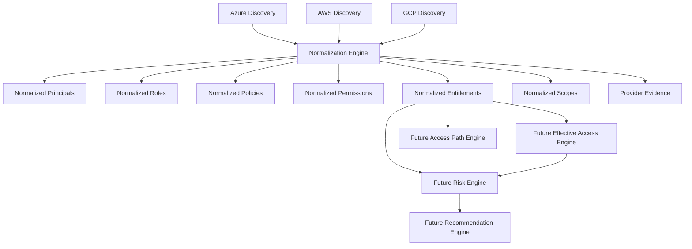

# Multi-Cloud Entitlement Normalization

Normalization is the provider-independent boundary between cloud discovery and future effective-access analysis. Azure, AWS, and GCP discovery snapshots are converted into shared principals, roles, policies, permissions, scopes, and entitlements without pretending their authorization semantics are identical.

## Semantic Preservation

- Azure `Actions`, `NotActions`, `DataActions`, and `NotDataActions` remain identifiable through permission access type, original permission, and provider evidence.
- AWS explicit `Deny`, `NotAction`, `NotResource`, wildcard actions/resources, policy statements, and trust relationships remain traceable to their policy source.
- GCP IAM conditions remain conditional with `EvaluationStatus=Unknown`; they are never treated as unconditional Allow. Parent-scope inheritance preserves source and target scopes.
- Direct, group, role, policy, inherited, assumed-role, service-identity, dynamic, and conditional assignment classifications remain distinct.

## Evidence and Diagnostics

Each normalized entitlement carries `ProviderEvidence` containing provider, source type/id, original document/statement/scope/assignment, collection time, and non-secret provider metadata. Unsupported or unevaluated features produce `NormalizationWarning` records and `PartiallyNormalized` status instead of disappearing silently.

## Idempotency and Performance

Stable deterministic keys deduplicate identical provider/account/principal/role/policy/permission/scope/access records. The normalization service operates on in-memory discovery snapshots and uses lookup-based validation; it does not issue cloud calls or calculate transitive effective access. Persistence/reconciliation can use the stable entitlement IDs without deleting scan history.

## Provider Mapping

Azure role assignments and role definitions map to direct/inherited role entitlements and control/data-plane permissions. AWS IAM policy statements map to policy entitlements and preserve explicit denies, conditions, and resource ARNs. GCP IAM bindings map to policy/role permissions, project scopes, service identities, and conditional bindings.

Permission strings remain provider-specific. `Microsoft.Storage/storageAccounts/read`, `s3:GetObject`, and `storage.objects.get` are valid normalized permissions but are not declared equivalent. Risk scoring, deny precedence, group expansion, role chaining, and complete access-path calculation belong to later milestones.
