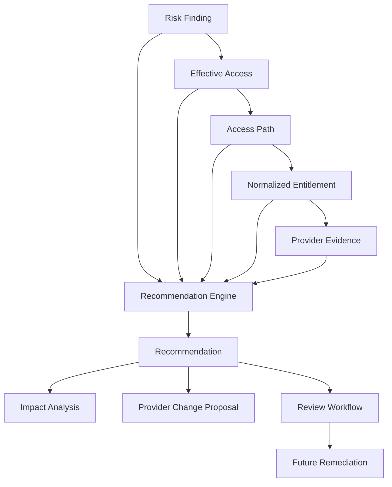

# Least-Privilege Recommendation Engine

The Recommendation Engine consumes the evidence chain produced by previous milestones:

Recommendations are analytical and reviewable. The engine never calls provider mutation APIs, requests credentials, executes remediation, changes policies, or disables identities.

## Rules and Safety

Modular rules cover unused permissions, wildcard narrowing, scope narrowing, broad-role review, redundant paths, dormant privilege, service-account permissions, privileged groups, nested privilege, long chains, and consolidation extension points. Recommendations are Confirmed only when the risk state and evidence chain support that certainty. Missing activity or broken evidence produces Potential/Unknown diagnostics or no recommendation.

Each recommendation stores before/after state, impact state, provider, principal/resource, risk finding, effective access, access path, entitlement, provider evidence, evaluation state, lifecycle status, and a deterministic fingerprint. Exact duplicates are removed within an evaluation and the stable fingerprint supports future cross-scan reconciliation.

Generated proposals retain provider-specific semantics: Azure separates control-plane `Actions` from data-plane `DataActions` when normalized permission metadata or a recognized operation form identifies the class, and preserves assignment conditions separately from the role definition; AWS emits per-action/resource IAM statements and retains parseable IAM `Condition` objects; GCP emits a custom role plus a separate binding scope and CEL condition because custom roles do not constrain resources. Source conditions are copied from normalized conditions or original provider evidence. If Azure action class or an AWS condition cannot be preserved, synthesis is withheld rather than silently broadening or dropping it. The envelope includes observed resource IDs and provider scope caveats.

Every generated policy is marked `reviewOnly`; provider proposal adapters are non-executable. Possible access loss is `UnknownImpact` unless a provider-side simulator validates the change. Activity absence only supports synthesis when the provider/account coverage proves a complete observation window; this does not prove business requirements are fully represented.

Provider proposal adapters produce non-executable Azure, AWS, and GCP review proposals. Approved is not Implemented; actual implementation belongs to a future remediation workflow with verification and user confirmation.

The desktop Policy Draft Workbench presents the stored current/proposed state, impact assessment, rationale, and evidence. It can export a JSON review draft marked `executable=false` and `approvalRequired=true`. Live findings without a normalized recommendation are not exportable as policy drafts. The workbench does not apply changes or claim an exact provider authorization simulation.

## Persistence and Security

The `AddRecommendationLifecycle` migration persists recommendation metadata and indexes for provider, type, status, evidence-chain references, and fingerprints. Flexible evidence is JSON/text; credentials, tokens, keys, and secrets are never stored or logged.
