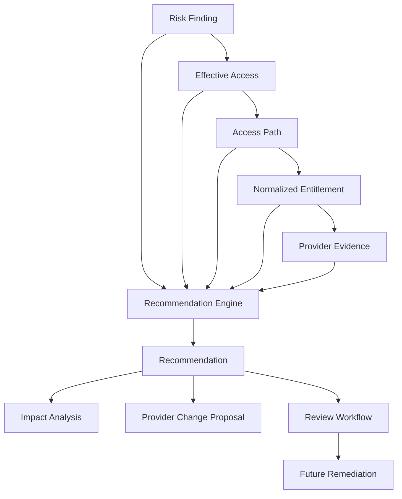

# Least-Privilege Recommendation Engine

The Recommendation Engine consumes the evidence chain produced by previous milestones:

Recommendations are analytical and reviewable. The engine never calls provider mutation APIs, requests credentials, executes remediation, changes policies, or disables identities.

## Rules and Safety

Modular rules cover unused permissions, wildcard narrowing, scope narrowing, broad-role review, redundant paths, dormant privilege, service-account permissions, privileged groups, nested privilege, long chains, and consolidation extension points. Recommendations are Confirmed only when the risk state and evidence chain support that certainty. Missing activity or broken evidence produces Potential/Unknown diagnostics or no recommendation.

Each recommendation stores before/after state, impact state, provider, principal/resource, risk finding, effective access, access path, entitlement, provider evidence, evaluation state, lifecycle status, and a deterministic fingerprint. Exact duplicates are removed within an evaluation and the stable fingerprint supports future cross-scan reconciliation.

Provider proposal adapters produce non-executable Azure, AWS, and GCP review proposals. Approved is not Implemented; actual implementation belongs to a future remediation workflow with verification and user confirmation.

## Persistence and Security

The `AddRecommendationLifecycle` migration persists recommendation metadata and indexes for provider, type, status, evidence-chain references, and fingerprints. Flexible evidence is JSON/text; credentials, tokens, keys, and secrets are never stored or logged.
