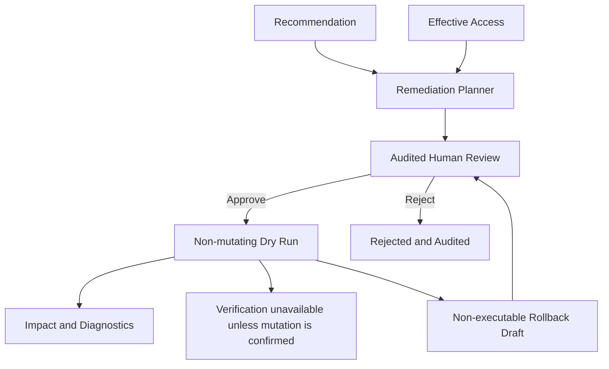

# Remediation Planning and Simulation

The remediation layer is a review-only boundary after Recommendations. It consumes recommendation evidence and EffectiveAccess records to create non-executable plans and conservative simulations.

## Safety Model

Plans contain before/after states, a provider target, rationale, and `Executable=false`. The planner never calls Azure, AWS, or GCP APIs, never obtains credentials, and never emits executable commands. Approval and rejection record an actor, timestamp, rationale, and audit event. `Approved` is intentionally separate from `Implemented`.

Simulation is structural only. It identifies affected EffectiveAccess records but reports `Unknown` access impact and `RequiresReview` status because provider authorization has not been re-evaluated and no mutation has occurred. Incomplete recommendation evidence remains a review concern rather than a false claim of safety. A dry run is gated on audited approval and does not perform a cloud write.

Plans and their audit metadata are stored locally at `%LOCALAPPDATA%\YASK-CIEM\remediation\plans.json`. Rollback preparation creates a separate non-executable plan that requires its own review and approval; it does not restore cloud state.

## Cloud Change Engine Boundary

`RemediationEngine` adds the execution lifecycle boundary without enabling mutation. It validates review plans, completes non-mutating dry runs, requires audited approval for execution attempts, and blocks live mode because provider mutation adapters are non-mutating stubs. Azure, AWS, and GCP adapters expose validation, apply, and verify hooks, but no provider write is enabled in this build.

The implemented workflow is:

`Plan -> Approval or Rejection -> Dry Run -> Verification status -> Optional rollback draft`

Verification is only attempted after an adapter confirms a mutation; otherwise the workflow records `Unavailable`. Rollback drafts remain non-executable and require separate approval. No access key, token, secret, or cloud command is acquired or executed by this layer.
