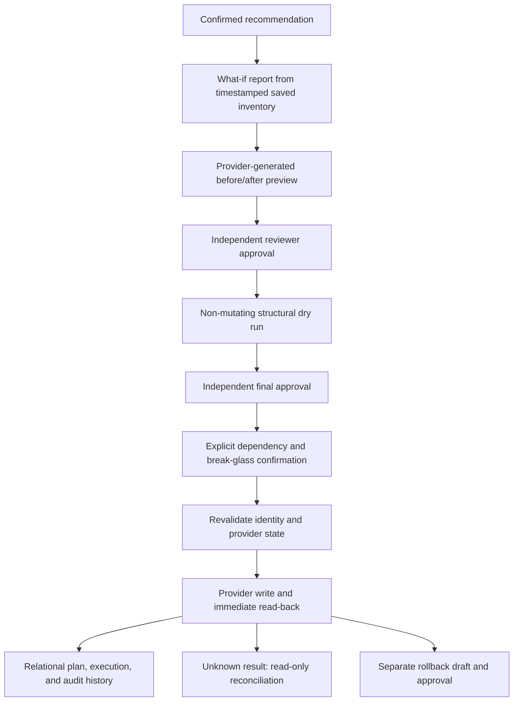

# Remediation Planning and Execution

The remediation workflow converts evidence-backed recommendations into approval-bound plans. It reuses the recommendation, effective-access, What-if, organization authorization, and provider administration services; it does not add a second authorization engine.

## Approval and execution controls

- New plans default to dry-run mode. The normal workflow first requires an independent review, then completes a structural dry run with no cloud mutation, then requires a second independent approval tied to the dry-run fingerprint.
- Live execution is currently limited to confirmed `RemoveUnusedPermission` recommendations. The user must prepare a provider-specific read-only preview; approval fingerprints include the provider request, captured before/after state, and What-if evidence.
- The final write is only available to the identity that prepared the provider preview, with current `ManageRemediations` and `ManagePolicies` authorization, a different final approver, fresh evidence, explicit workload/dependency and break-glass attestation, and a separate confirmation dialog.
- The cloud administration service rechecks organization authorization, cloud identity, and current provider state before writing. It reads state again after the write. A mismatch or uncertain result is not retried automatically; only read-only reconciliation is offered.
- Rollback uses the provider service's captured before-state, is a separate plan, requires fresh post-change inventory and What-if analysis, and receives its own approvals and explicit confirmation. Rollback is blocked if the post-change provider snapshot is missing or stale.
- Provider previews are held in memory by the cloud administration service. The local journal is for audit/recovery evidence and does not authorize replay after restart. A new preview and approval are required in a new session.

The manual dependency checkbox is an operator attestation, not computed evidence that workloads are unaffected. Providers do not expose a universal reversible operation; if the captured state cannot be restored safely, do not attempt rollback.

## Current supported scope and limitations

The desktop UI accepts explicit target details and produces a provider-native before/after preview. The current constrained operations are AWS managed-policy detach or inline-policy deletion, Azure role-assignment removal, and GCP allow-policy updates that remove existing bindings or members without introducing roles, members, or changed conditions. Other cloud-administration operations remain available only in the separate manual administration workflow and cannot be selected by this recommendation workflow.

The What-if report models the exact normalized permission action identified by the recommendation. It does **not** prove that the entire provider-native diff removes only that action; the reviewer must inspect the full before/after state. Provider action-to-entitlement correlation, generalized least-privilege policy generation, multi-action policy diffs, and operational dependency analysis remain incomplete. The system therefore does not automatically generate, approve, or remove permissions.

Execution uses the local desktop provider CLI identity and is an actual cloud write when the user explicitly completes every gate. Automated tests use fake provider command runners; no live cloud mutation is part of the test suite. Live provider integration must be validated in a separately authorized test tenant before production use.

## Persistence

Application startup applies the EF Core migrations. Remediation plans, proposed actions, approval snapshots, execution history, rollback changes, and audit entries are stored in the existing SQLite database. Existing local JSON plans are imported into SQLite when read; malformed JSON is surfaced and left intact rather than silently replaced. The audit is local and mutable, not centralized or tamper-proof.

The `RemediationPlanStore` rejects common credential/token patterns before persistence. Raw provider policy state may contain sensitive metadata; access to the local database and backups must be protected using the existing endpoint and backup controls.

## Manual validation

1. Sign in to an organization with `ManageRemediations` and `ManagePolicies`; bind the provider account.
2. Select a confirmed `RemoveUnusedPermission` recommendation backed by a recent saved inventory timestamp. Create its plan and check the What-if report, provider target, and complete before/after diff.
3. Prepare the provider preview. Have a different authorized reviewer approve, then run the non-mutating dry run.
4. Have a second independent reviewer approve the dry-run result.
5. In an isolated test account, review operational and break-glass dependencies, check the confirmation box, and explicitly apply. Verify the provider read-back and audit status.
6. If needed, collect a fresh post-change inventory, prepare a separate rollback draft, review its inverse What-if result, approve it independently, and explicitly roll it back.
7. Test a simulated unknown-write response and use reconciliation. Do not retry an unknown operation.

Never use production credentials for initial validation. The explicit operator gates do not replace change control or a cloud-side recovery plan.
