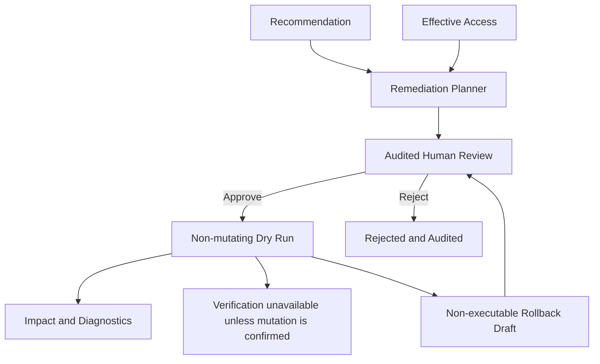

# Remediation Planning and Simulation

The remediation layer is a review-only boundary after Recommendations. It consumes recommendation evidence and EffectiveAccess records to create non-executable policy previews, approval records, conservative simulations, and rollback previews.

## Safety Model

Plans contain before/after states, a provider target, rationale, and `Executable=false`. The planner never calls Azure, AWS, or GCP APIs, never obtains credentials, and never emits executable commands. Approval and rejection record an actor, timestamp, rationale, and audit event. A reviewer must differ from the recorded plan creator, and only evidence-confirmed plans can be approved. Initial approval stores a SHA-256 fingerprint over the recommendation preview, forward changes, and rollback changes; dry runs are blocked if any of that content changes. After a completed non-mutating dry run, a second reviewer must approve the exact dry-run result before live execution is even considered. `Approved` is intentionally separate from `Implemented`.

Simulation is structural only. It identifies affected EffectiveAccess records but reports `Unknown` access impact and `RequiresReview` status because provider authorization has not been re-evaluated and no mutation has occurred. Incomplete recommendation evidence remains a review concern rather than a false claim of safety. A dry run is gated on audited approval and does not perform a cloud write.

The desktop workflow uses the existing Microsoft Entra interactive sign-in, configured with `YASK_CIEM_ENTRA_CLIENT_ID` and the selected organization's Entra tenant. It binds requester and approver records to Entra user object IDs and requires the `ManageRemediations` organization permission. Organization Admins and Security Analysts receive that permission by default; custom roles can be granted it explicitly. Auditors and Viewers cannot approve. The requester cannot approve or reject their own plan, and final execution approval must come from a different user than the dry-run approver.

Plan snapshots remain local at `%LOCALAPPDATA%\YASK-CIEM\remediation\plans.json`. Remediation audit entries are also inserted once into the existing local SQLite `AuditEvents` table, with actor and organization IDs. Rollback preparation creates a separate non-executable plan that requires its own review and approval; it does not restore cloud state. This is an interim local audit path, not centralized or tamper-proof storage: the organization directory and SQLite database are both locally mutable. Production approval requires server-side authorization and centralized immutable audit storage before any provider write is enabled.

## Cloud Change Engine Boundary

`RemediationEngine` adds the execution lifecycle boundary without enabling mutation. It validates review plans, completes non-mutating structural dry runs, requires independent approval bound to the unchanged preview for execution attempts, and blocks live mode because provider mutation adapters are non-mutating stubs. Azure, AWS, and GCP adapters expose validation, apply, and verify hooks, but no provider write is enabled in this build.

The implemented workflow is:

`Policy Preview -> Independent Approval -> Non-mutating Dry Run -> Independent Final Approval -> Live Execution Disabled -> Rollback Draft`

The final approval fingerprint covers the change set and dry-run result. Verification is only attempted after an adapter confirms a mutation; otherwise the workflow records `Unavailable`. Rollback drafts remain non-executable and require separate approval. All current provider adapters remain non-mutating, so live apply and rollback are unavailable. No access key, token, secret, or cloud command is acquired or executed by this layer.
