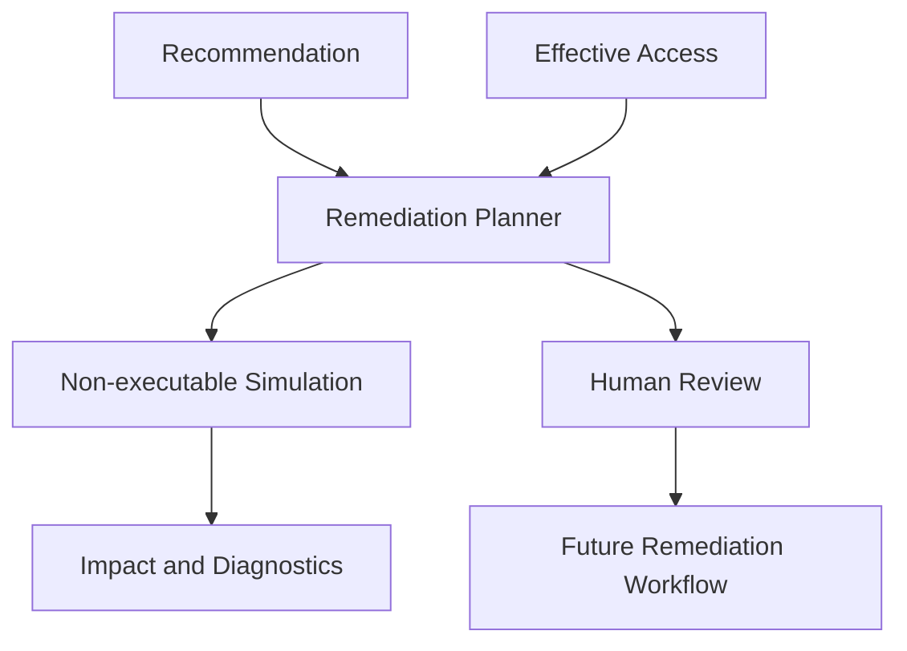

# Remediation Planning and Simulation

The remediation layer is a review-only boundary after Recommendations. It consumes recommendation evidence and EffectiveAccess records to create non-executable plans and conservative simulations.

## Safety Model

Plans contain before/after states, a provider target, rationale, and `Executable=false`. The planner never calls Azure, AWS, or GCP APIs, never obtains credentials, and never emits executable commands. `Approved` is intentionally separate from `Implemented`.

Simulation is structural only. It identifies affected EffectiveAccess records but reports `Unknown` access impact and `RequiresReview` status because provider authorization has not been re-evaluated and no mutation has occurred. Incomplete recommendation evidence remains a review concern rather than a false claim of safety.

Future remediation can add approval, dry-run provider adapters, user confirmation, verification, and rollback without changing the analytical recommendation or simulation contracts.

## Cloud Change Engine Boundary

`RemediationEngine` adds the execution lifecycle boundary without enabling mutation. It validates review plans, completes dry runs, requires explicit approval for live mode, and currently blocks live mode because provider mutation adapters are non-mutating stubs. Azure, AWS, and GCP adapters expose validation, apply, and verify hooks for a future controlled implementation.

This preserves the required sequence:

`Plan -> Approval -> Dry Run -> Provider Change -> Verification`

Only the first three stages are available. No access key, token, secret, or cloud command is acquired or executed by this layer.
