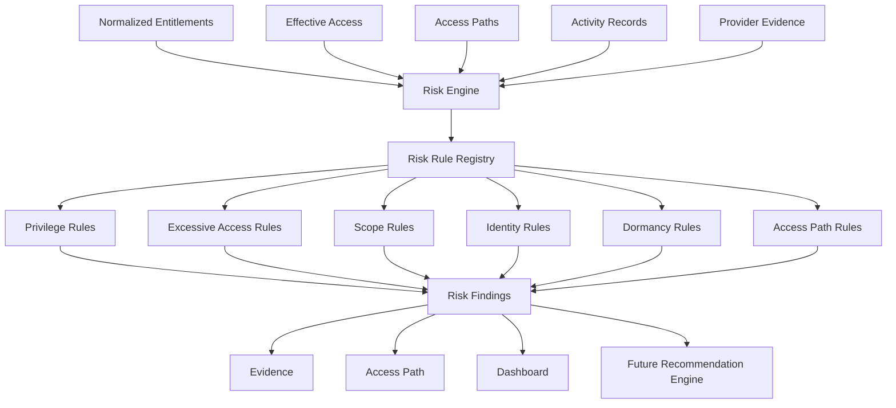

# Multi-Cloud CIEM Risk Engine

The Risk Engine consumes normalized entitlements, authoritative EffectiveAccess records, AccessPath graphs, principals, resources, roles, permissions, and activity metadata. It does not call cloud APIs or reimplement Azure, AWS, or GCP authorization.

## Rules and Accuracy

The registry contains CIEM-001 through CIEM-017 for privileged identities, excessive permissions, wildcard permissions, broad scope, dormancy, external identities, service identities, unused entitlements, production administration, redundant paths, privileged groups, nested privilege, wildcard resources, long chains, unused role assignments, and exploitable identity-to-resource paths.

Rules emit `Confirmed`, `Potential`, `Unknown`, or `Unsupported` evaluation states. Missing activity remains Unknown, powerful access is not automatically called excessive, service identities are not inherently risky, and broad scope requires evidence. Each finding contains provider, principal/resource/effective-access/access-path references, evidence, category, severity, deterministic fingerprint, and lifecycle status. The exploitable-path rule joins principal characteristics and effective access to modeled paths plus public-exposure, sensitive-data, critical-asset, and workload-vulnerability signals. Signal timestamps and per-signal coverage affect `PriorityScore`; stale evidence lowers score and yields `Potential`, while missing or unknown coverage is included explicitly in evidence details. The desktop list is sorted by the quality-adjusted score.

## Lifecycle and Persistence

Findings use Open, Resolved, Accepted, and Ignored states. Fingerprints support exact deduplication and future scan reconciliation. The `AddRiskFindingLifecycle` migration persists evaluation state, category, rule version, fingerprint, timestamps, access-path references, and evidence. Secrets and credentials are never stored.

Rule failures are isolated and logged as diagnostics so one failed rule does not prevent other rules from running. Dormancy, path thresholds, and the signal freshness window are configurable through `RiskRuleOptions`. Live scans now preserve Azure resource tags and selected network properties (`publicNetworkAccess`, `allowBlobPublicAccess`, and `networkAcls.defaultAction`), GCP Cloud Asset labels, and AWS Resource Groups Tagging API inventory, then map explicit exposure, data-classification, critical-asset, and CVE/workload-vulnerability hints into typed signals. AWS inventory requires `tag:GetResources` and includes tagged resources only. Tag/label signals are unconfirmed and coverage is `Partial`; they are useful leads, not substitutes for Defender for Cloud, Inspector, Security Command Center, or a data-classification scanner. Native cloud vulnerability findings are not yet queried. Missing or unavailable provider data is not treated as a safe result.

Kubernetes workload-trust mismatches are represented separately as `WorkloadIdentityRisk` signals; verified, denied, unavailable, unsupported, and not-configured checks retain distinct coverage states. The live scan builds resource paths from provider-reported role assignments and in-scope resources, then runs the existing `CIEM-017` attack-path rule. These role-level edges are deliberately `PartiallyEvaluated` and findings remain `Potential`; action-level authorization and runtime conditions are not inferred. Signal nodes, coverage, modeled paths, and graph findings are persisted with the seven-day scan history and shown in Access Paths/Risk Findings. AccessPath nodes continue to distinguish modeled access evidence from observed attacker activity.
