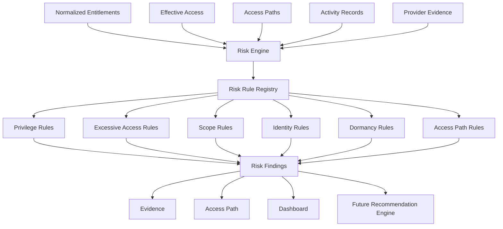

# Multi-Cloud CIEM Risk Engine

The Risk Engine consumes normalized entitlements, authoritative EffectiveAccess records, AccessPath graphs, principals, resources, roles, permissions, and activity metadata. It does not call cloud APIs or reimplement Azure, AWS, or GCP authorization.

## Rules and Accuracy

The registry contains CIEM-001 through CIEM-015 for privileged identities, excessive permissions, wildcard permissions, broad scope, dormancy, external identities, service identities, unused entitlements, production administration, redundant paths, privileged groups, nested privilege, wildcard resources, and long chains.

Rules emit `Confirmed`, `Potential`, `Unknown`, or `Unsupported` evaluation states. Missing activity remains Unknown, powerful access is not automatically called excessive, service identities are not inherently risky, and broad scope requires evidence. Each finding contains provider, principal/resource/effective-access/access-path references, evidence, category, severity, deterministic fingerprint, and lifecycle status.

## Lifecycle and Persistence

Findings use Open, Resolved, Accepted, and Ignored states. Fingerprints support exact deduplication and future scan reconciliation. The `AddRiskFindingLifecycle` migration persists evaluation state, category, rule version, fingerprint, timestamps, access-path references, and evidence. Secrets and credentials are never stored.

Rule failures are isolated and logged as diagnostics so one failed rule does not prevent other rules from running. Dormancy and path thresholds are configurable through `RiskRuleOptions`. Risk ranking, remediation, recommendations, and subjective overall security scores are intentionally excluded from this milestone.
