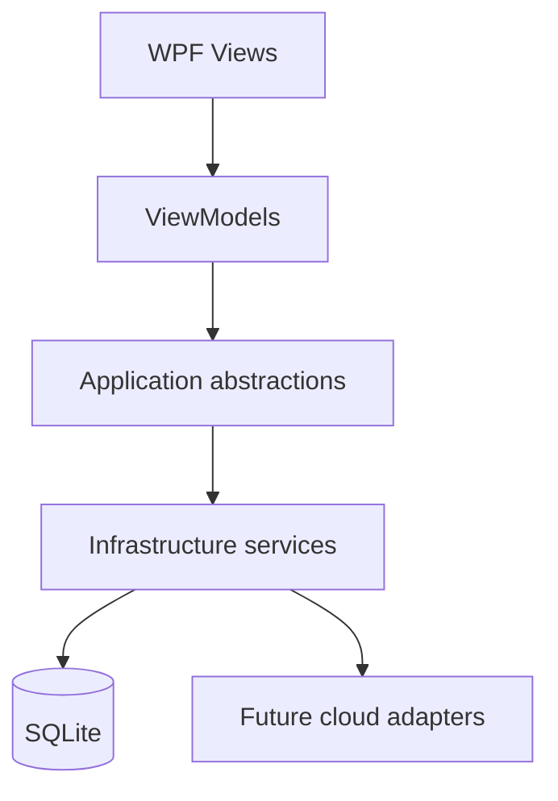

# WPF and MVVM Shell

CloudEntitle CIEM uses a WPF shell with a strict presentation boundary:

## Navigation

`MainWindowViewModel` owns the navigation surface and current presentation state. `INavigationService` resolves and caches screen ViewModels by type, so repeated navigation does not create an unbounded number of instances. The shell uses a `ContentControl` and centralized templates rather than constructing Views from ViewModels.

The current routes are Dashboard, Cloud Accounts, Identities, Resources, Entitlements, Effective Access, Risk Findings, Recommendations, Scan History, and Settings.

## Startup and Services

`App` configures dependency injection, Serilog rolling logs under `%LOCALAPPDATA%\\CloudEntitle\\Logs`, global exception handlers, and the main window. Dialog interactions are isolated behind `IDialogService`. The shell contains no cloud SDK calls or direct EF Core queries.

The existing persistence and provider services remain behind Infrastructure/Application boundaries. No cloud scanning or authentication runs during startup.

## State and Error Handling

Workspace ViewModels expose loading, error, and empty-state properties. The shell provides placeholders until later milestones supply demo and provider data. Unexpected UI and task failures are logged with user-friendly messages; secrets and credentials are not logged.

## Future Integration

Milestone 5 Demo Mode will populate the same normalized domain model used by real provider adapters. Later Azure, AWS, and GCP adapters will remain outside the WPF project and flow through Application abstractions into Infrastructure persistence.
